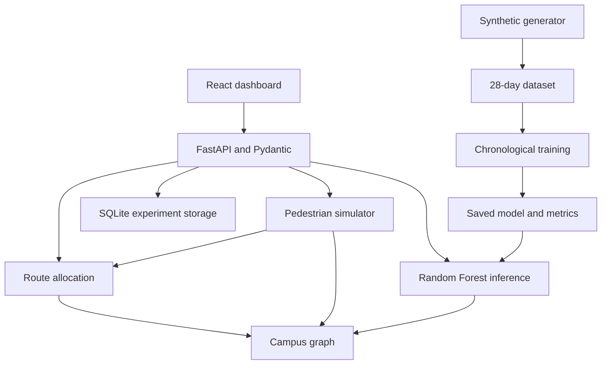

# Architecture and component responsibilities

## The end-to-end system

FastAPI serves the built dashboard and its API on one port. The frontend fetches live backend state; no API replies or benchmark values are invented in browser code. Leaflet uses CRS.Simple to render the fictional campus in metre coordinates, with all vectors supplied locally. Recharts visualizes actual API metrics and executed experiment records.

## State and data ownership

| Component | Owns | Key files |
|---|---|---|
| Graph | 36 nodes, 66 undirected pathways, distances, widths, capacities and dynamic state | algorithms/campus.py |
| Routing | Dijkstra/A*, candidate routes, assignment reservations and estimated costs | algorithms/routing.py |
| Simulation | Individual agents, departure requests, clock, occupancy, progress, reroute history | simulation/engine.py |
| ML | Feature schema, trained RF, model evaluation and range warnings | ml/features.py, train.py, predictor.py |
| API | Validated requests and guarded shared state | backend/app.py, schemas.py |
| Persistence | Experiment JSON records and action log | backend/storage.py |
| Browser | Selected page, input values, route preview and playback timer | frontend/src/App.jsx |

Simulation state lives in memory. SQLite is recreated automatically when absent and stores experiments/actions. A process restart starts a clean live simulation while retaining stored experiment records. SQLite paths can be overridden with `CROWDFLOW_DB` for isolation in tests.

## Prediction and routing loop

1. Observe edge occupancies and trailing entries.
2. Form the same feature columns used during training. Historical snapshots are sampled every five simulated minutes; forecasts update every 30 simulated seconds.
3. Predict five-minute occupancy with the saved RF. Flag values outside training ranges.
4. Compute alternative routes using forecast travel times and an overlap penalty.
5. Reserve assignment occupancy globally on shared edges while allocating small groups.
6. Admit agents to open edges when physical space is available.
7. Advance their positions using actual congestion-dependent speed.
8. At nodes, consider rerouting with current occupancy, forecasts and remaining route commitments. Require meaningful benefit to prevent rapid switches.

Initial routing accounts for other waiting/walking agents' future commitments. At a new node, an agent's own reservations are removed before evaluating a replacement; changed reservations are then applied before following agents decide.

## One discrete tick

A tick is five seconds. The simulator applies a scheduled closure, releases due demand, updates forecast/history if due, plans waiting groups, admits pedestrians, freezes pathway speeds for the tick, moves all walkers, releases completed edges, records counts and samples progress. Agents can traverse at most one edge per tick; unused time is not carried onto the next edge. On this campus all free-flow edge traversal times exceed a tick, preventing multiple-edge teleportation.

Occupancy is shared between directions of an undirected pathway. There is a physical ceiling and a separate lower comfort threshold. Nodes have unbounded waiting queues in this simplified model. Space and collision avoidance inside nodes are not simulated.

## API concurrency

An RLock guards shared simulation changes and state snapshots. Controlled experiments use independent Simulation objects; they do not overwrite the live simulator. The immutable RF is used for inference in both workflows. Inference uses one CPU thread per forest prediction to avoid repeated worker overhead. Training may use multiple cores.

This is designed for one local demonstration, not many browser users. Every running browser tab can request steps, so keep one live dashboard open. There is no distributed state management, authentication or production rate limiting.

## Build and deployment choice

The requested Python/scikit-learn backend is delivered as a local executable project. A static-only hosted page would not run that backend. The included Vite production build is served by FastAPI, preserving one origin and avoiding production CORS setup. The Vite development proxy is available for editing. Cloud hosting was not required for the local college demonstration.

The runtime needs no map tile provider, credentials, internet after installation, or paid external service.
